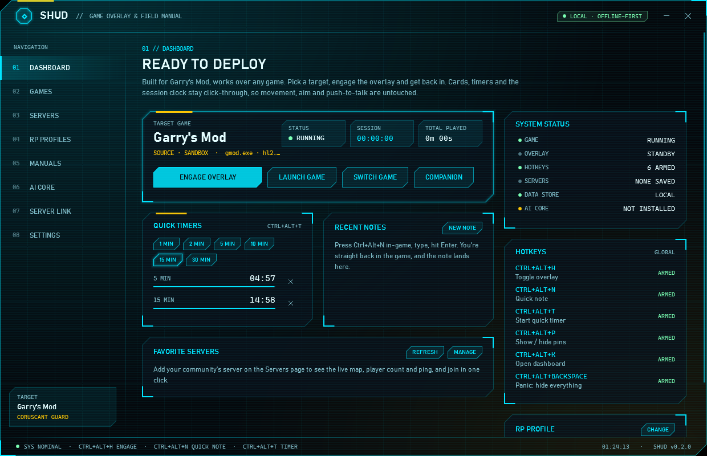
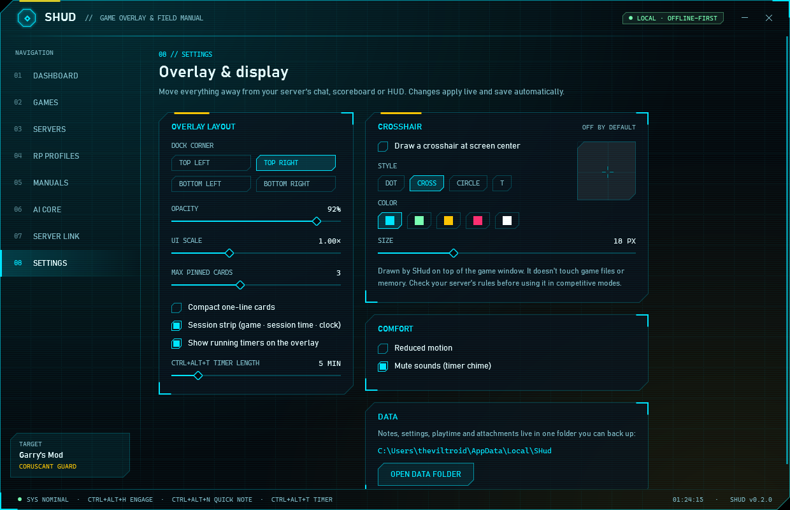

  

<h1 align="center">SFHud</h1>

  <b>A sci-fi overlay and note pad for Garry's Mod roleplay.</b> 
  Notes, timers, DEFCON levels, a crosshair and a music player, drawn over your game and stored only on your PC.

  
  
  
  

  <a href="#download">Download</a> ·
  <a href="#features">Features</a> ·
  <a href="docs/USER-GUIDE.md">User guide</a> ·
  <a href="docs/KEYBINDS.md">Keybinds</a> ·
  <a href="docs/BUILDING.md">Build from source</a>

---

  

SFHud is a **click-through overlay** for Star Wars RP, Zombie Survival, Military RP, DarkRP or any other server. It works over any game in borderless or windowed mode. Nothing is injected into the game and SFHud never reads game memory, so it is safe to run next to anti-cheat.

This repository holds the **full version of SFHud**, free and open source: every feature, no account, no license and no time limit. Donating on Ko-fi is optional.

## Download

Get the newest version from **[Releases](https://github.com/TermsMet/SFHud/releases/latest)**:

| File | Use it for |
|---|---|
| `SFHud-Setup-<version>.exe` | The installer. It needs no admin rights, and updating keeps all your data. |

Each release lists the installer's SHA-256 checksum, so you can verify the download.

You don't need to install anything else, because the .NET runtime is built into the exe. Windows SmartScreen may warn you because the exe is not code-signed. Choose **More info → Run anyway**. Full steps are in **[docs/INSTALL.md](docs/INSTALL.md)**.

## Features

<table>
<tr>
<td width="50%" valign="top">

### 📝 Note pads
- Unlimited pads with titles, icons, colours, categories and pins
- Markdown-style formatting, colours, task lists and timestamps
- Paste or drop images and resize them inline
- Search across all pads, with undo and draft autosave
- Pop any note out onto the overlay
- Import and export as `.sfhudpad`, `.txt` or `.md`

</td>
<td width="50%" valign="top">

### 🖥️ Overlay
- Status strip, clock, timers, DEFCON badge, server intel, pads, info cards, a music player and labels
- Every element can be styled: colours, font, size, opacity, border and corners
- Customize mode (**Alt+~**) with snapping, guides, undo/redo and Revert/Apply
- Up to 5 pages per preset, switched with hotkeys
- Scales from 4:3 CRT resolutions up to 4K

</td>
</tr>
<tr>
<td valign="top">

### 🚨 DEFCON
- Six levels by default. Add, rename, recolour and reorder them, including named levels like `LOCKDOWN`
- Each level can have its own sound, toast, flash and opacity
- Change levels by hotkey or accept suggestions taken from `console.log` or pasted status text
- SFHud only suggests a level and never changes it without you

</td>
<td valign="top">

### ⏱️ Timers · 🎯 Crosshair · 🎵 Music
- Countdowns, stopwatches and repeating rounds (`7m30s patrol`, `@21:30 event`, `every 10m patrol`)
- 10 built-in beeps, or import your own `.wav` or `.mp3`
- 12 crosshair shapes with outlines and saved presets
- A music player right on the overlay, with track progress, shown only in game. It works with Spotify, browsers, the Steam overlay and more

</td>
</tr>
<tr>
<td valign="top">

### 🎨 Look
- Themes: Classic, Republic, Light, Midnight, Dark red, Blue, Purple, Zombie, Military, General
- Built-in server presets: **Star Wars RP**, **Zombie Survival**, **Military RP**, **General RP**
- Accent colour, corners, fonts, scanlines and animations

</td>
<td valign="top">

### 💾 Your data
- Everything stays in `%LOCALAPPDATA%\SFHud`
- Rolling backups and automatic recovery if a file is damaged
- Export and import everything to move to another PC
- Nothing is uploaded

</td>
</tr>
</table>

  

## Quick start

1. Install SFHud and launch it.
2. Under **Games & servers**, pick your game and a server preset.
3. Set the game to **borderless** or **windowed** mode.
4. In game, press **Alt+~** to arrange the overlay, then **Apply**.

| Key | Action |
|---|---|
| **Alt+~** | Customize the overlay in game |
| **Ctrl+Alt+N** | Quick note into the current pad |
| **Ctrl+Alt+J** | Open the note pads window |
| **Ctrl+T** | Quick timer |
| **Ctrl+Alt+PgUp / PgDn** | DEFCON up / down |
| **Ctrl+Alt+H** | Show / hide the overlay |
| **Ctrl+Alt+Backspace** | Hide everything instantly |

You can rebind every key. The full list is in **[docs/KEYBINDS.md](docs/KEYBINDS.md)**.

## Documentation

| Guide | Contents |
|---|---|
| [Install & update](docs/INSTALL.md) | Installer, updates, uninstalling, troubleshooting |
| [User guide](docs/USER-GUIDE.md) | Pads, the overlay, DEFCON, presets, timers, crosshair, music, themes |
| [Keybinds](docs/KEYBINDS.md) | Every default shortcut and how rebinding works |
| [Note formatting](docs/NOTE-FORMATTING.md) | The formatting syntax for notes |
| [Data & privacy](docs/DATA.md) | Where files are stored, backups, moving to a new PC |
| [Building from source](docs/BUILDING.md) | SDK, build script flags, command-line switches |
| [Contributing](CONTRIBUTING.md) | How to send changes |

## Free, with everything

SFHud is free and open source, with every feature included: the offline local AI, DEFCON auto-detection, a layout per DEFCON level, video on the overlay, unlimited pages and profiles, custom themes, a companion window and event alerts from chat. There's no paid edition, no license key and no account.

If SFHud helps you, you can support it on [Ko-fi](https://ko-fi.com/theslorb) (the **DONATE** button in the app opens it). Completely optional.

## Credits

- Visual style based on two MIT-licensed kits (design values only, no code): [boy-offi9-inc/scifi-ui-kit](https://github.com/boy-offi9-inc/scifi-ui-kit) and [jonnysmillie/astro-sci-fi-ui](https://github.com/jonnysmillie/astro-sci-fi-ui).
- Recommended fonts (SIL OFL): [Orbitron](https://fonts.google.com/specimen/Orbitron) and [Share Tech Mono](https://fonts.google.com/specimen/Share+Tech+Mono). Without them, SFHud uses Windows fonts.

## License

SFHud is released under the **[GNU General Public License v3.0](LICENSE)**.

Enjoying SFHud? <a href="https://ko-fi.com/theslorb">Support it on Ko-fi</a> ☕

